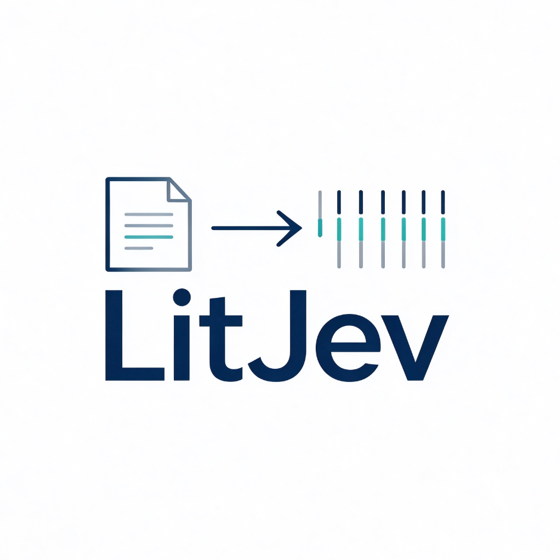

<div align="center">
  
</div>

# LitJev

**A calibrated, single-pass decision model for academic manuscript screening.**

> LitJev is a research snapshot, not a replacement for expert peer review.

---

# LitJev 中文简介

**面向学术文献初筛的、可校准、单次前向决策模型。**

> LitJev 是研究阶段模型，不是专家评审的替代品。

---

## English

LitJev maps a manuscript title and abstract to 12 typed decisions, each with
an independent probability in `[0,1]`. It does not generate prose and does not
produce a total paper score. A single forward pass emits:

- craft: `clarity`, `method_type`, `rigor`, `reproducibility`, `experiments_support`
- value: `long_term_impact`, `expert_accept`, `silent_source_potential`, `paradigm_trajectory`
- integrity: `citation_chain_clean`, `misconduct_signal`
- coverage: `in_coverage`

The model is a 4B-parameter cross-encoder built on Qwen3.5-4B. It uses a
last-token pooled representation and a small two-way head. The released
snapshot is `full-v3.1`.

For a description of training, supervision design, benchmark, limitations, and
results, see [`MODEL_CARD.md`](MODEL_CARD.md) and the paper under [`paper/`](paper/).

### Download model weights

The full `full-v3.1` weights are published as a model repository (the Git tree
itself does not store the multi-GB weights):

- Hugging Face: <https://huggingface.co/yuyang-rgb094/LitJev-v3.1>
- ModelScope: coming soon (intended primary channel for mainland China)

```bash
bash download_model.sh ./model
```

The script tries ModelScope, then Hugging Face, then the GitHub release, is
resumable on all three, and verifies every file against `SHA256SUMS`. The old
GitHub `v3.1` release assets stay online as a historical channel but are **not
recommended**: `gh release download` cannot resume, and the first shard had to
be cut into `.part-*` pieces.

### Quick start

```bash
pip install -r requirements.txt
python inference.py --model-dir ./model --question in_coverage \
  --title "A short title" --abstract "A longer abstract..."
```

`inference.py` loads the base model and `head_final.pt`, tokenizes the
paper/proposition pair with the same template as training, and prints the
probability for the requested question.

### Repo layout

```text
download_model.sh download and reassemble the release weights
model/            local model weights (after download)
paper/            manuscript in Markdown and LaTeX
inference.py      minimal one-shot inference example
MODEL_CARD.md     technical model card
Handoff.md        project handoff and next-step roadmap
```

### License note

Our added code and head weights are released under the [MIT License](LICENSE).

The base model is [Qwen/Qwen3.5-4B](https://www.modelscope.cn/models/Qwen/Qwen3.5-4B),
licensed under the Apache License 2.0. LitJev `full-v3.1` is a fine-tuned derivative of
it, and **all model weights were modified during training**. The full Apache-2.0 text is
reproduced in [LICENSE-base](LICENSE-base), with attribution in [NOTICE](NOTICE).

## 中文

LitJev 将论文标题和摘要映射为 12 个类型化判断，每个判断独立输出一个
`[0,1]` 之间的概率。它不生成自然语言评审，也不输出论文总分。单次前向即可得到：

- 工艺维度：`clarity`、`method_type`、`rigor`、`reproducibility`、`experiments_support`
- 价值维度：`long_term_impact`、`expert_accept`、`silent_source_potential`、`paradigm_trajectory`
- 诚信维度：`citation_chain_clean`、`misconduct_signal`
- 覆盖维度：`in_coverage`

模型是基于 Qwen3.5-4B 的 4B 参数 cross-encoder，采用 last-token pooling 和小型
二分类 head。本次开源快照为 `full-v3.1`。

训练、监督设计、评测基准、局限性与结果见 [`MODEL_CARD.md`](MODEL_CARD.md)，
论文草稿见 [`paper/`](paper/)。

### 下载模型权重

完整 `full-v3.1` 权重以模型仓库形式发布（不放入 Git 提交历史）：

- Hugging Face：<https://huggingface.co/yuyang-rgb094/LitJev-v3.1>
- 魔搭 ModelScope：建设中（计划的国内主渠道）

```bash
bash download_model.sh ./model
```

脚本按 魔搭 → Hugging Face → GitHub Release 的顺序尝试，三条链路均支持续传，
并用 `SHA256SUMS` 校验全部文件。旧的 GitHub `v3.1` Release 资产保留为历史渠道，
但**不推荐**：`gh release download` 不支持断点续传，首个分片还被迫切成 `.part-*`。

### 快速开始

```bash
pip install -r requirements.txt
python inference.py --model-dir ./model --question in_coverage \
  --title "论文标题" --abstract "论文摘要..."
```

`inference.py` 会加载 base model 与 `head_final.pt`，使用训练相同模板构造输入，
并输出所请求问题的概率。

### 目录结构

```text
download_model.sh 下载并重建 release 权重
model/            本地模型权重（下载后生成）
paper/            论文 Markdown 与 LaTeX
inference.py      最小单次推理示例
MODEL_CARD.md     技术模型卡
Handoff.md        项目交接与后续路线图
```

### 许可说明

我们新增的代码与 head 权重使用 [MIT License](LICENSE) 开源。

基座模型为 [Qwen/Qwen3.5-4B](https://www.modelscope.cn/models/Qwen/Qwen3.5-4B)，
采用 Apache License 2.0 许可。LitJev `full-v3.1` 是其微调衍生版本，**全部模型权重
在训练中已被修改**。Apache-2.0 许可证全文见 [LICENSE-base](LICENSE-base)，
归属声明见 [NOTICE](NOTICE)。
